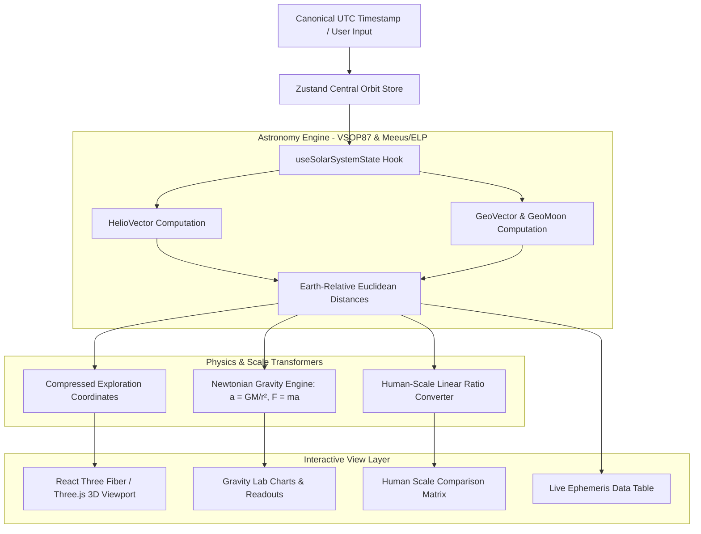

# OrbitSpan 🪐

> **"I didn't want to simply look at the Solar System. I wanted to understand its scale."**

An interactive astrophysics and orbital scale engine that calculates real planetary positions, true Newtonian gravitational pull on the human body, and translates cosmic distances into intuitive, human-scale physical benchmarks.

🔗 **[Live Deployment: orbitspan.vercel.app](https://orbitspan.vercel.app/)**

[](https://github.com/RootDeveloperDS/Orbit-Span)
[](https://opensource.org/licenses/MIT)
[](https://www.typescriptlang.org/)
[](https://react.dev/)
[](https://threejs.org/)
[](https://developer.mozilla.org/en-US/docs/Web/Progressive_web_apps)

---

## 🌌 Why I Built This — The Origin Story

This project started from a simple question born out of daily curiosity:

We frequently hear bold claims surrounding the planets:
* *"Planets have gravitational effects on our lives."*
* *"Planetary alignments dictate human destiny, energy, and personality."*
* *"Mars or Saturn is pulling on you right now."*

As an engineering student, this prompted a direct, quantifiable inquiry:

> **"If planets exert gravitational forces on us, exactly how large are those forces? Can I calculate them live? Can I compare them against everyday objects? And can I make those unfathomable astronomical distances truly understandable to a human mind?"**

I wanted to move past abstract assertions and calculate the underlying physics directly. 

Gravity is governed by a well-established mathematical law:

$$a = \frac{G \cdot M}{r^2} \quad \text{and} \quad F = m \cdot a$$

Where:
* $G = 6.67430 \times 10^{-11} \text{ m}^3\text{kg}^{-1}\text{s}^{-2}$ (Universal Gravitational Constant)
* $M$ = Mass of the celestial body $(\text{kg})$
* $r$ = Instantaneous Euclidean distance between Earth and the celestial body $(\text{m})$
* $m$ = Observer mass $(\text{kg})$

However, solving the equations revealed a second, deeper visualization challenge: **astronomical scale is impossible for the human brain to intuitively picture.**

Saying that *the Sun is approximately 149.6 million kilometres away* is scientifically accurate, but the human mind has no daily reference for 149,600,000 km. It is just an abstract string of numbers.

That prompted the central visualization breakthrough of this project:

> **"What happens if we shrink the entire Solar System down so Earth is the exact size of a human fist (~10 cm)?"**

* How far away would the Moon sit? *(A couple steps away — ~3 metres).*
* How far would the Sun be? *(A short walk down the road — ~1.17 kilometres).*
* Where would Neptune be located? *(In the next town — ~35 kilometres away).*

**OrbitSpan** was engineered to turn that question into an interactive reality.

---

## 🎯 The Core Motive: Measurable Physics over Vague Claims

The goal of this project is **not** to claim that gravity is imaginary. Quite the contrary: **gravity is real, universal, measurable, and mathematically predictable.**

The critical distinction is between:
1. **The physical phenomenon:** *A celestial body exerts a gravitational acceleration on all mass in the universe.*
2. **The astrological claim:** *That tiny gravitational acceleration dictates a human's destiny, fortune, or personality.*

The first is rigorous physics. The second is an extraordinary claim that lacks empirical evidence or a known physical mechanism.

OrbitSpan approaches this with calm, factual scientific respect:
* **Astronomy** models and predicts measurable physical bodies and their orbits using Newtonian mechanics and general relativity.
* **Astrology** is a cultural and historical tradition, but its predictive claims regarding human affairs are not substantiated by the actual gravitational tugs computed here.

Instead of hand-waving, OrbitSpan provides **live planetary coordinates, real-time Euclidean distance vectors, Newtonian acceleration readouts, and human-scale model benchmarks**.

---

## 📏 The Human-Scale Intuition Model

Standard 3D Solar System visualizers distort distances so that planets can fit onto a computer screen. While convenient, it severely misleads human intuition about how empty space actually is.

OrbitSpan introduces a mathematically rigorous **Human Scale Engine**. Users can select a physical reference scale for Earth:

| Reference Earth Diameter | Linear Scale Ratio | Moon Distance | Sun Distance | Jupiter Distance (Avg) | Neptune Distance (Avg) |
| :--- | :--- | :--- | :--- | :--- | :--- |
| **1 cm** *(Marble)* | $1 : 1,274,200,000$ | ~0.30 m | ~117 m | ~610 m | ~3.5 km |
| **5 cm** *(Golf Ball)* | $1 : 254,840,000$ | ~1.51 m | ~587 m | ~3.05 km | ~17.6 km |
| **10 cm** *(Approx. Fist)* | **$1 : 127,420,000$** | **~3.02 m** | **~1.17 km** | **~6.10 km** | **~35.2 km** |
| **25 cm** *(Basketball)* | $1 : 50,968,000$ | ~7.54 m | ~2.93 km | ~15.26 km | ~88.1 km |
| **1.0 m** *(Giant Globe)* | $1 : 12,742,000$ | ~30.17 m | ~11.74 km | ~61.05 km | ~352.5 km |

*(Note: All distances are re-evaluated live from instantaneous planetary ephemeris vectors and vary as planets move through their orbits).*

---

## ⚡ Gravity Lab: Real-Time Newtonian Forces

In the **Gravity Lab** (`/gravity-lab`), users can input their exact body mass (e.g., $70\text{ kg}$) and inspect the true gravitational force exerted by every solar system body at its current astronomical distance.

$$\text{Acceleration: } a = \frac{G \cdot M_{\text{body}}}{r^2} \quad \left[\frac{\text{m}}{\text{s}^2}\right]$$
$$\text{Force: } F = m_{\text{observer}} \cdot a \quad [\text{N}]$$

### Example Live Magnitude Comparison (70 kg human):
* **Earth Surface Gravity:** $\approx 686.7\text{ N}$ ($9.80665\text{ m/s}^2$)
* **The Moon:** $\approx 0.0023\text{ N}$ ($3.3 \times 10^{-5}\text{ m/s}^2$) — *Dominant tidal body due to proximity.*
* **The Sun:** $\approx 0.41\text{ N}$ ($5.9 \times 10^{-3}\text{ m/s}^2$) — *Largest raw acceleration.*
* **Jupiter (at Closest Approach):** $\approx 0.000029\text{ N}$ ($4.1 \times 10^{-7}\text{ m/s}^2$).
* **A Person Standing 1 Metre Away (70 kg):** $\approx 0.00000033\text{ N}$ ($4.7 \times 10^{-9}\text{ m/s}^2$).

> 💡 **Physical Insight:** A building next to you or a fellow passenger on a train produces a gravitational acceleration on your body comparable to or greater than the distant outer planets.

---

## 🌟 Core Features

- 🪐 **Real Ephemeris 3D Engine**: Live planetary orbits computed via the VSOP87 planetary series and Meeus/ELP lunar theory (via Astronomy Engine).
- 🕒 **UTC Simulation Timeline**: Full scrubbable timeline with forward/reverse playback, real-time speed multipliers ($1\times$ to $1000\times$), step navigation, and a canonical UTC clock.
- 🔭 **Three Rendering Modes**:
  1. **Scientific / Real-Scale Mode**: True relative planetary radii and astronomical distances.
  2. **Exploration Mode**: Mathematically compressed distances with enlarged planetary meshes for interactive clarity.
  3. **Human-Scale Mode**: Physical real-world distance translation cards.
- ⚖️ **Interactive Gravity Lab**: Live gravitational force, acceleration, Earth percentage comparisons, and logarithmic force spectrum visualizations (via Recharts).
- 🔬 **Science & Methodology Library**: Transparent mathematical documentation of constant derivations, inverse-square laws, acceleration vs. force, and coordinate systems.
- 📴 **Offline-First PWA**: Service worker shell architecture that caches simulation algorithms, ephemerides, and assets for 100% offline functionality.
- ♿ **Adaptive Performance Mode**: Hardware-aware reduced effects toggle for smooth 60fps rendering across low-power mobile GPUs.

---

## 🏗️ Technical Architecture & Data Flow

OrbitSpan is strictly client-first. There are **zero runtime NASA API dependencies** and **no server-side physics bottlenecks**. All ephemerides and vector mathematics execute locally in the client browser.



---

## 🛠️ Technology Stack

| Layer | Technologies | Purpose |
| :--- | :--- | :--- |
| **Core Framework** | React 19, TypeScript 5.8 | Modern reactive component architecture & type safety |
| **Routing & Meta** | TanStack Router / TanStack Start | Fast client-side routing, SSR-ready layout & dynamic metadata |
| **3D Graphics** | Three.js, React Three Fiber, Drei | WebGL accelerated solar system visualization & camera rigs |
| **Astronomy Engine** | `astronomy-engine` (Don Cross) | VSOP87 analytical planetary series & high-precision vectors |
| **State Management** | Zustand 5 | Decoupled high-frequency simulation state management |
| **Styling & UI** | Tailwind CSS v4, Radix UI, Lucide Icons | Responsive glassmorphic observatory design system |
| **Visualizations** | Recharts 2 | Responsive logarithmic gravitational force charts |
| **PWA & Offline** | Service Worker Cache API | Instant offline accessibility & static asset caching |
| **Bundling & Testing**| Vite 8, Vitest, ESLint | Sub-second HMR builds & unit test validation |

---

## 🔬 Scientific Scope & Limitations

Scientific integrity requires transparency regarding assumptions and approximations:

1. **Analytical Ephemeris**: Orbital positions are computed from the VSOP87 planetary series. While accurate to within arcseconds over centuries, it is an analytical series rather than an integrated N-body relativistic ephemeris (such as JPL DE440).
2. **Point-Mass Center-to-Center Approximation**: Distances $r$ are measured from Earth's center to the target body's center. The $\approx 6,371\text{ km}$ radius of Earth is negligible at planetary distances ($> 38,000,000\text{ km}$).
3. **Absolute Acceleration vs. Local Inertial Frame**: The Gravity Lab calculates the *absolute gravitational acceleration* exerted by a body at Earth's orbital distance. Because Earth and the observer are in mutual free-fall around the Sun, the *felt tidal force* on a human body is differential ($\propto \frac{1}{r^3}$) and vastly smaller than the raw acceleration ($\propto \frac{1}{r^2}$).
4. **Exploration Mode Distances**: Exploration Mode deliberately applies a non-linear compression function to distances and magnifies planetary radii so that bodies remain clickable and visible on a screen.
5. **Circular Ring Approximations**: Visualized orbit rings are drawn at mean semi-major axes ($a$); individual planet positions follow their true Keplerian eccentricities.

---

## 🚀 Getting Started

### Prerequisites
* [Node.js](https://nodejs.org/) (v18.0.0 or higher) or [Bun](https://bun.sh/)
* npm, yarn, or bun package manager

### Local Installation

```bash
# 1. Clone the repository
git clone https://github.com/RootDeveloperDS/Orbit-Span.git
cd Orbit-Span

# 2. Install dependencies
bun install
# or
npm install

# 3. Start local development server
bun run dev
# or
npm run dev
```

Open `http://localhost:5173` in your browser to explore.

### Production Build & Verification

```bash
# Type check and build production bundle
bun run build
# or
npm run build

# Preview production build locally
bun run preview
```

---

## 🗺️ Product Roadmap

- [x] **V1.0 (Current Stable)**: 
  - Live VSOP87 3D Solar System simulation.
  - Scientific, Exploration, and Human-Scale rendering modes.
  - Complete Gravity Lab with configurable observer mass.
  - Offline PWA service worker caching.
  - Scientific & methodology documentation.
- [ ] **V1.1 (Phase 1)**:
  - Logarithmic depth buffer camera zoom for zero-clipping planet inspection.
  - High-resolution PBR surface maps and atmospheric rim scattering shaders.
- [ ] **V1.2 (Phase 2)**:
  - 5,000+ instanced Main Asteroid Belt objects (`THREE.InstancedMesh`).
  - Live astronomical event scanner (oppositions, conjunctions, eclipses).
- [ ] **V1.3 (Phase 3)**:
  - Interactive RK4 N-body gravity spacecraft slingshot sandbox.
  - Differential tidal force & Roche limit inspector.
- [ ] **V2.0 (Phase 4)**:
  - WebXR spatial computing support (Apple Vision Pro / Meta Quest VR mode).
  - AR Tabletop Mode for projecting the 10 cm Human-Scale Earth onto physical desks.

---

## 🤝 Contributing

OrbitSpan is **100% open source** and warmly welcomes contributions from developers, astronomers, students, and educators!

1. Fork the Project repository.
2. Create your Feature Branch (`git checkout -b feature/AstronomicalPhenomena`).
3. Commit your Changes (`git commit -m 'feat: Add Kuiper belt dwarf planet ephemerides'`).
4. Push to the Branch (`git push origin feature/AstronomicalPhenomena`).
5. Open a Pull Request.

---

## 📚 Data Sources & Acknowledgments

* **Ephemeris Library**: [Astronomy Engine](https://github.com/cosinekitty/astronomy) by Don Cross (MIT License).
* **Planetary Constants & Fact Sheets**: NASA / JPL Solar System Dynamics.
* **Fundamental Physical Constants**: CODATA recommended values (2018/2022).
* **Earth Dimensions & Astronomical Unit**: International Astronomical Union (IAU 2012 resolution).

---

## 👤 Author & Story

Built with passion and scientific curiosity by **Devansh Sharma**.

* **Portfolio**: [devanshsharma.vercel.app](https://devanshsharma.vercel.app/)
* **Company**: [RootDeveloperDS](https://rootdeveloperds.odoo.com)
* **GitHub**: [@RootDeveloperDS](https://github.com/RootDeveloperDS)
* **LinkedIn**: [devanshsharma987](https://www.linkedin.com/in/devanshsharma987)
* **Twitter / X**: [@devanshsha6563](https://x.com/devanshsha6563)
* **Telegram**: [@developerofroot](https://t.me/developerofroot)
* **Email**: `developersofroot@gmail.com`

---

## 📄 License

This project is licensed under the MIT License — see the [LICENSE](LICENSE) file for details.
